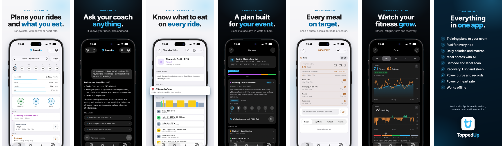

  

<h1 align="center">ToppedUp</h1>

The AI coach that plans your rides and what you eat. 
Training plan, fueling for every ride and daily nutrition in one app, for iPhone and Android.

  <a href="https://toppedup.cc"><b>toppedup.cc</b></a> ·
  <a href="https://toppedup.cc/faq.html">FAQ</a> ·
  <a href="../../issues/new/choose">Feedback</a>

## What it does

- **Training plans to your event.** Blocks that build to race day, in watts or heart rate.
- **Fuel for every ride.** How many carbs per hour, what to eat and when, based on the workout.
- **Daily calories and macros.** Log a meal with a photo, a barcode scan or a search.
- **An AI coach you can just ask.** It knows your rides, your plan and what you ate.
- **Fitness, fatigue and form.** Recovery, HRV, sleep, power curve and records.
- **Works with what you ride with.** Apple Health, Wahoo, Hammerhead and intervals.icu.

## About this repository

ToppedUp is built by [Chainline Studio](https://chainlinestudio.com). The source code is private.
This repository is the public home of the app:

- **[Releases](../../releases)** list what changed in each version.
- **[Issues](../../issues/new/choose)** are open for bug reports and feature ideas.
- **[Roadmap](ROADMAP.md)** gives the big picture.

Found a security issue? Please don't open an issue. Read [SECURITY.md](SECURITY.md).

## Contact

contact@chainlinestudio.com
